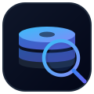
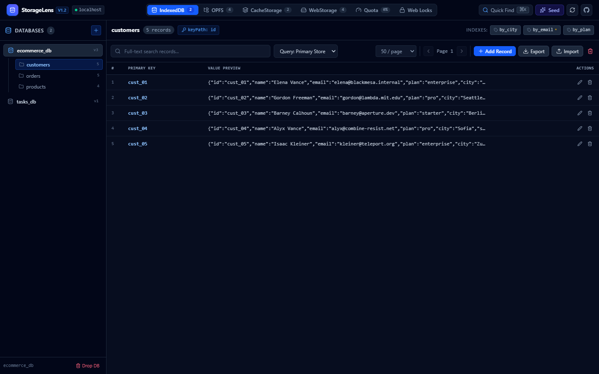
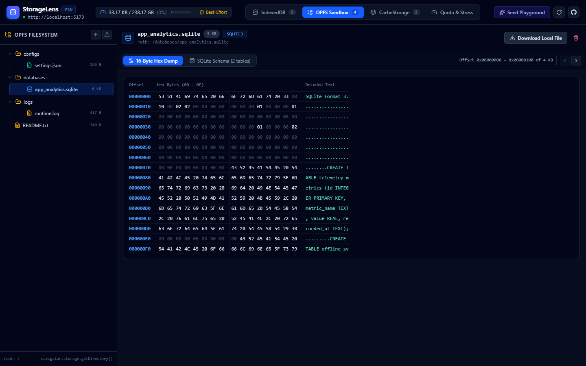
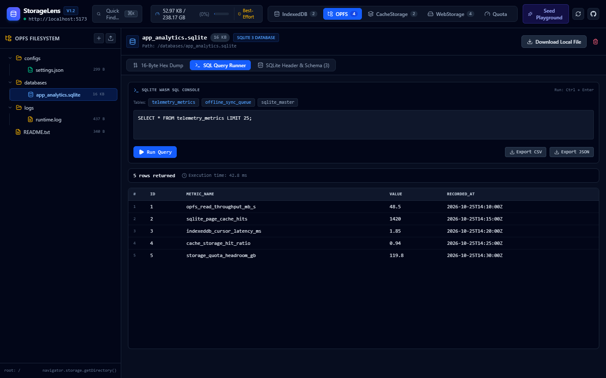
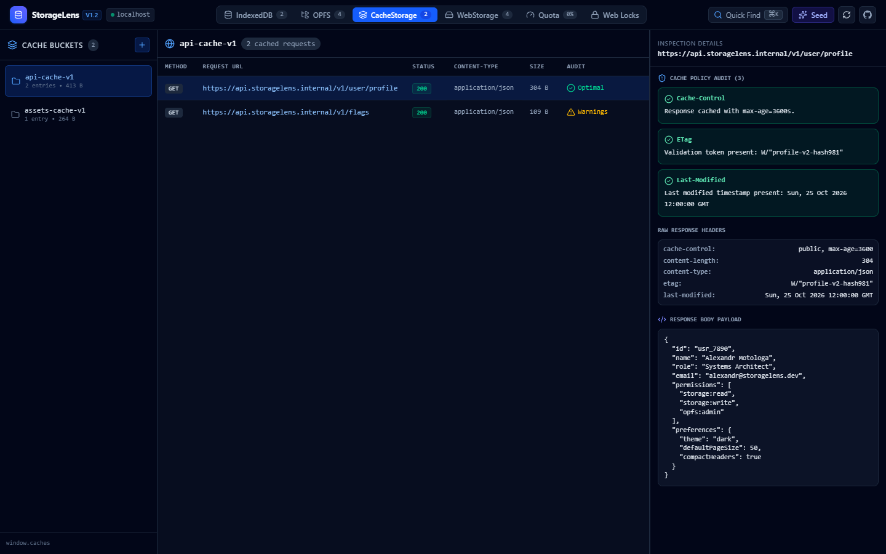
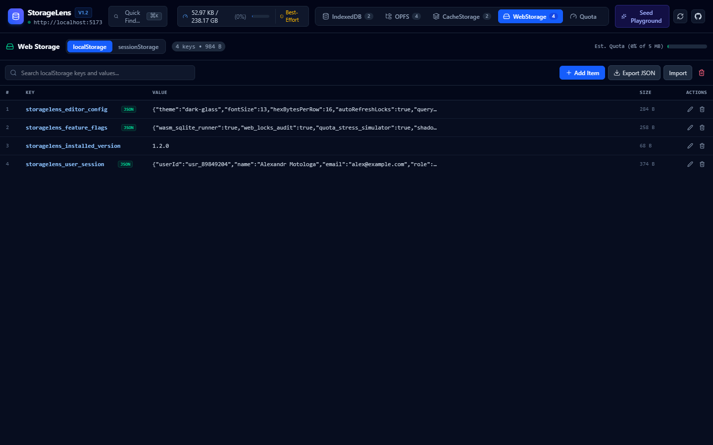
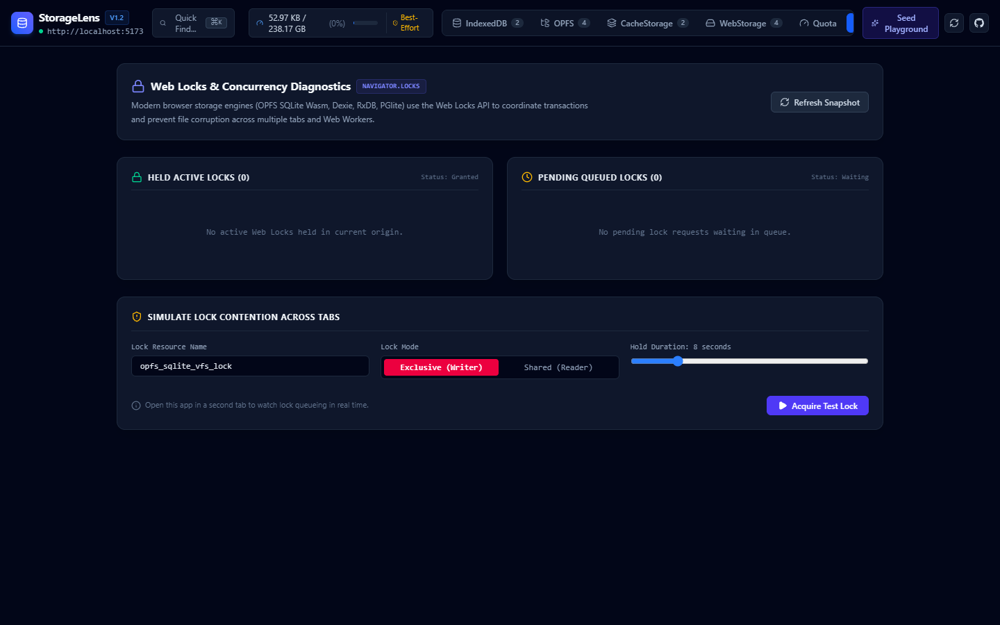
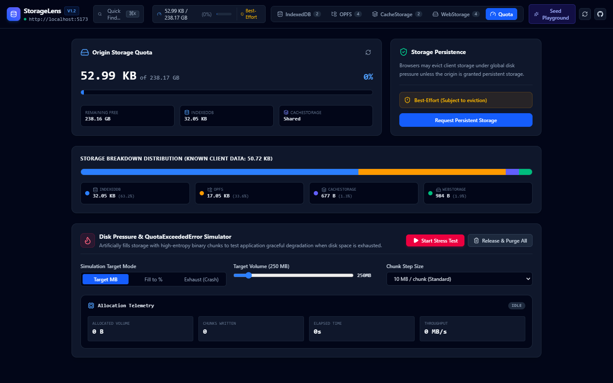
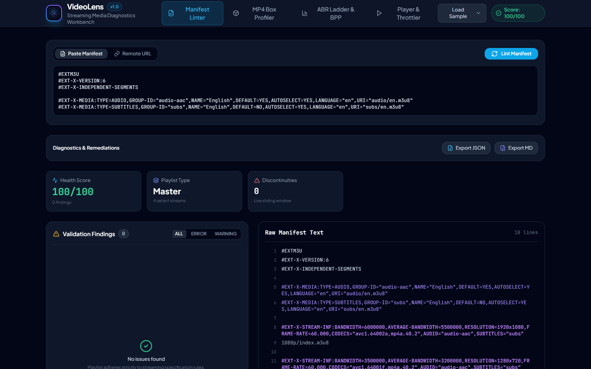

<p align="center">
  
</p>

<h1 align="center">StorageLens</h1>

<p align="center">
  Browser client storage and offline database workbench for IndexedDB, OPFS, CacheStorage, Web Storage, and Web Locks.
</p>

<p align="center">
  
  
  
  
  
  
</p>

---

## Overview

StorageLens is an in-browser developer studio that replaces the Chrome DevTools Application tab. It provides schema introspection for IndexedDB, virtualized file browsing and 16-byte hex inspection for the Origin Private File System (OPFS), live in-browser SQL queries on SQLite databases via Wasm, header auditing for ServiceWorker CacheStorage, byte-level tracking for Web Storage, cross-tab lock contention monitoring via the Web Locks API, and a disk quota stress simulator for verifying QuotaExceededError handling.

It runs as a standalone web application and as an embeddable shadow DOM drawer that injects into web applications without style collisions.


---

## Core Capabilities

### 1. IndexedDB Studio and Query Engine
- Discovers all databases and object stores via `indexedDB.databases()`.
- Reflects versions, keyPath definitions, autoIncrement flags, and indexes.
- Implements cursor pagination with forward and backward navigation for large datasets.
- Filters records in memory across keys and nested JSON values.
- Supports inline record insertion, updates, deletions, and store clearing.
- Exports object stores to formatted JSON, CSV, and SQL INSERT statements.
- Imports JSON record arrays into any target store with validation.



### 2. Origin Private File System (OPFS) Sandbox Explorer
- Traverses the virtual directory hierarchy from `navigator.storage.getDirectory()`.
- Displays file names, folder structures, byte sizes, and modification timestamps.
- Decodes SQLite 3 100-byte database headers: page size, format versions, change counter, page count, and text encoding.
- Parses root B-tree pages to extract table names and DDL statements.
- Includes a 16-byte chunked hex dump viewer with offset calculation, hex pairs, and ASCII representation.
- Provides an interactive byte decoding inspector for int8, uint8, uint16LE, uint32LE, binary, and ASCII formats.
- Supports binary sequence and plain text search with instant offset jumps.
- Provides 1-click file downloads directly to the host operating system.



### 3. SQLite Wasm Live SQL Console
- Mounts OPFS SQLite databases into an in-memory WebAssembly SQLite engine (`sql.js`).
- Executes arbitrary SQL statements with sub-millisecond execution timing and row count telemetry.
- Displays tabular query results with structured columns and data types.
- Exports query results directly to CSV or formatted JSON.
- Generates valid binary SQLite 3 databases directly from the browser environment.



### 4. ServiceWorker CacheStorage Auditor
- Inspects cache buckets registered in `window.caches`.
- Analyzes cached request and response pairs with HTTP status codes and MIME types.
- Audits response headers for `Cache-Control`, `max-age`, `ETag`, and `Last-Modified` compliance.
- Flags missing cache policies, zero max-age settings, and wildcard Vary headers.
- Previews JSON payloads, formatted text, and live rendered image assets.
- Allows deleting individual entries or purging complete cache buckets.



### 5. Unified Web Storage Studio
- Manages `localStorage` and `sessionStorage` in a unified studio interface.
- Calculates exact UTF-16 byte sizes for individual keys and total storage usage.
- Detects JSON payloads automatically and opens an interactive JSON viewer.
- Shows live quota capacity meters against standard browser storage limits.
- Supports adding, editing, deleting keys, clearing stores, and JSON import/export.



### 6. Web Locks API Concurrency Diagnostics
- Queries active and pending lock queues using `navigator.locks.query()`.
- Distinguishes between shared and exclusive lock modes across tabs and web workers.
- Displays holding client IDs and lock resource names.
- Includes an interactive lock contention simulator to test offline-first database contention.



### 7. Disk Quota and QuotaExceededError Stress Tester
- Reads `navigator.storage.estimate()` for total usage, quota, and percentage.
- Breaks down storage usage across IndexedDB, OPFS, CacheStorage, and Web Storage via an interactive distribution chart.
- Checks storage persistence and requests persistent storage via `navigator.storage.persist()`.
- Simulates quota exhaustion by writing controlled binary chunks to a temporary IndexedDB store.
- Supports Target MB, Target Percentage, and complete Disk Exhaustion modes.
- Captures real `DOMException: QuotaExceededError` events with stack traces and throughput telemetry.
- Reclaims allocated space instantly with a 1-click purge operation.



### 8. Global Command Palette (`⌘K`)
- Opens an instant modal search with `Ctrl + K` or `Cmd + K`.
- Provides fuzzy matching across all databases, object stores, OPFS files, and cache buckets.
- Offers quick action shortcuts to run seeds, clear caches, switch tabs, and trigger quota simulations.



---

## Architecture

StorageLens is built in modular TypeScript libraries with a React 19 UI layer:

```
src/
├── indexeddb/       # Schema reflection, cursor pagination, CRUD, and exporters
├── opfs/            # Recursive directory walker, hex formatter, SQLite parser, and sql.js runner
├── cache/           # window.caches reader, response cloner, and header auditor
├── webstorage/      # Unified localStorage and sessionStorage manager and quota meter
├── locks/           # Web Locks API query inspector and contention simulator
├── quota/           # navigator.storage.estimate calculator, breakdown chart, and stress allocator
├── playground/      # Sample data generators for IndexedDB, OPFS SQLite, Cache, and Web Storage
├── components/      # React 19 data grids, tree views, inspectors, modals, and Command Palette
├── drawer/          # Shadow DOM host and embeddable storagelens.js library
└── hooks/           # Reactive state hooks for each storage subsystem
```

---

## Getting Started

### Prerequisites
- Node.js 20 or higher
- Modern browser supporting IndexedDB and OPFS (Chrome, Edge, Safari 15.2+, Firefox 111+)

### Installation

```bash
git clone https://github.com/alexandrmotologa/storagelens.git
cd storagelens
npm install
```

### Development Server

Start the local development server:

```bash
npm run dev
```

Open `http://localhost:5173` in your browser. Click the **Seed Playground** button in the header to populate sample data across IndexedDB, OPFS SQLite, CacheStorage, and Web Storage.

### Production Build

Build the standalone application:

```bash
npm run build
```

Build the embeddable shadow DOM library:

```bash
npm run build:drawer
```

The output bundle is generated at `dist-drawer/storagelens.js`.

---

## Embeddable In-Page Drawer

You can embed StorageLens into any existing web app or Progressive Web App.

### Script Tag Integration

Add the bundle to your HTML:

```html
<script src="dist-drawer/storagelens.js"></script>
```

A floating badge will appear in the bottom-right corner. You can toggle the studio with `Ctrl + Shift + S` (or `Cmd + Shift + S` on macOS).

### Programmatic API

Control the drawer through the window object:

```javascript
// Open the studio
window.__STORAGELENS__.open();

// Close the studio
window.__STORAGELENS__.close();

// Toggle visibility
window.__STORAGELENS__.toggle();

// Check open state
console.log(window.__STORAGELENS__.isOpen());
```

---

## Testing

Run unit and integration tests using Vitest:

```bash
npm test
```

The test suite contains 29 tests across 8 test suites covering:
- IndexedDB schema reflection, cursor pagination, and record CRUD.
- OPFS hex formatting and SQLite 3 header decoding.
- OPFS byte decoding inspector and binary pattern search.
- SQLite query execution result exporters for CSV and JSON.
- CacheStorage header validation rules.
- Web Storage item management, quota estimation, and JSON import/export.
- Web Locks API query verification and simulated lock acquisition.
- Quota formatting, headroom checks, and stress tester lifecycle.

---

## License

MIT License. Authored by Alexandr Motologa.
